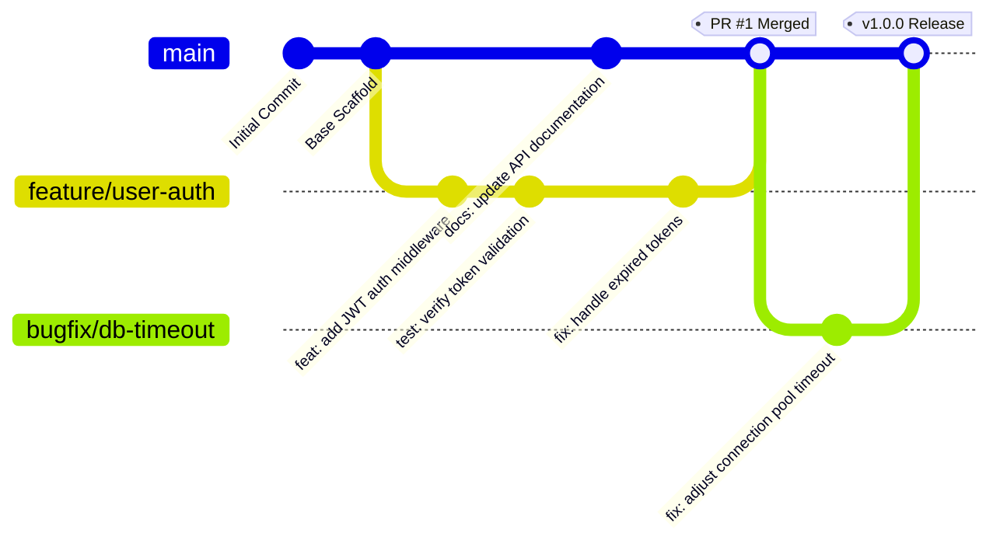

# DevOps Git & Collaboration Mastery Hands-On Lab

<div align="center">

[](https://github.com/codewithmuh/devops-training/releases)
[](https://opensource.org/licenses/MIT)
[](https://github.com/codewithmuh/devops-training/stargazers)
[](https://github.com/codewithmuh/devops-training/network/members)
[](https://git-scm.com/)
[](https://github.com/)
[](https://www.youtube.com/@codewithmuh)

**A hands-on, practical lab environment for mastering Git version control, branching strategies, conflict resolution, Pull Request workflows, and Conventional Commits for DevOps engineers.**

[Overview](#overview) • [Branching Architecture](#git-workflow--branching-architecture) • [Hands-On Exercises](#hands-on-practice-exercises) • [Conventional Commits](#conventional-commits-specification) • [Cheatsheet](#git-quick-reference)

</div>

---

## Overview

Version control is the backbone of all modern DevOps and Continuous Integration/Continuous Deployment (CI/CD) practices. This repository serves as a sandbox environment where engineers can practice feature branching, remote collaboration, merge conflict resolution, and trunk-based continuous delivery without risking production code.

---

## Git Workflow & Branching Architecture



---

## Hands-On Practice Exercises

### Lab 1: Branch Isolation & Pull Request Flow

1. **Clone the repository:**
   ```bash
   git clone https://github.com/codewithmuh/devops-training.git
   cd devops-training
   ```

2. **Create a dedicated feature branch:**
   ```bash
   git switch -c feature/add-healthcheck
   ```

3. **Implement your changes and stage:**
   ```bash
   echo "GET /healthz 200 OK" >> healthcheck.txt
   git add healthcheck.txt
   ```

4. **Commit using Conventional Commits:**
   ```bash
   git commit -m "feat(api): implement standard healthcheck endpoint"
   ```

5. **Push upstream and open a Pull Request:**
   ```bash
   git push -u origin feature/add-healthcheck
   ```

---

### Lab 2: Simulating & Resolving Merge Conflicts

1. **Modify a common line on your branch:**
   ```bash
   echo "DevOps Training Lab Update - Branch A" > Notes.txt
   git commit -am "chore: update notes from branch A"
   ```

2. **Simulate a conflicting commit on `main`:**
   ```bash
   git checkout main
   echo "DevOps Training Lab Update - Branch Main" > Notes.txt
   git commit -am "chore: update notes from main"
   ```

3. **Attempt to merge:**
   ```bash
   git merge feature/add-healthcheck
   # CONFLICT (content): Merge conflict in Notes.txt
   ```

4. **Resolve the conflict:**
   Open `Notes.txt`, choose the correct lines between `<<<<<<< HEAD`, `=======`, and `>>>>>>>`, save the file, and finalize:
   ```bash
   git add Notes.txt
   git commit -m "fix(merge): resolve conflicting notes updates"
   ```

---

## Conventional Commits Specification

Standardized commit messages ensure automated changelogs and clean repository history:

| Prefix | Description | Example |
|---|---|---|
| `feat:` | Introduces a new feature or capability | `feat(auth): add OAuth2 Google login provider` |
| `fix:` | Patches a bug or defect | `fix(cors): permit localhost origins in development` |
| `docs:` | Updates documentation or README files | `docs(readme): add architecture flowchart and setup guide` |
| `chore:` | Maintenance tasks, dependency updates | `chore(deps): bump actions/checkout to v4` |
| `ci:` | CI/CD pipeline modifications | `ci(github): add automated trivy security scan job` |
| `refactor:`| Code refactoring without changing functionality | `refactor(db): migrate connection logic to singleton` |

---

## Git Quick Reference

Inspect [`commands.txt`](commands.txt) for an exhaustive list of essential daily Git commands covering branching, stashing, log visualization, and reset mechanics.

---

## Resources & Community

- **Full DevOps Training Hub:** [devops-training-resources](https://github.com/codewithmuh/devops-training-resources)
- **LinkedIn Community:** [Follow Muhammad Rashid](https://www.linkedin.com/in/codewithmuh)
- **YouTube Tutorials:** [CodeWithMuh Channel](https://www.youtube.com/@codewithmuh)

---

## License

This project is licensed under the [MIT License](LICENSE).
